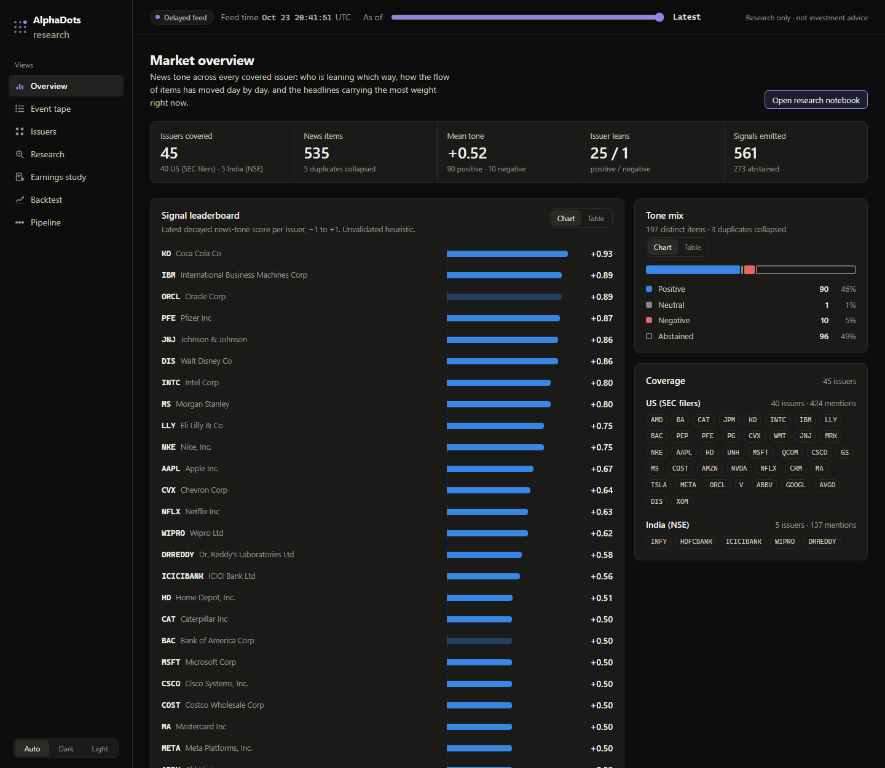
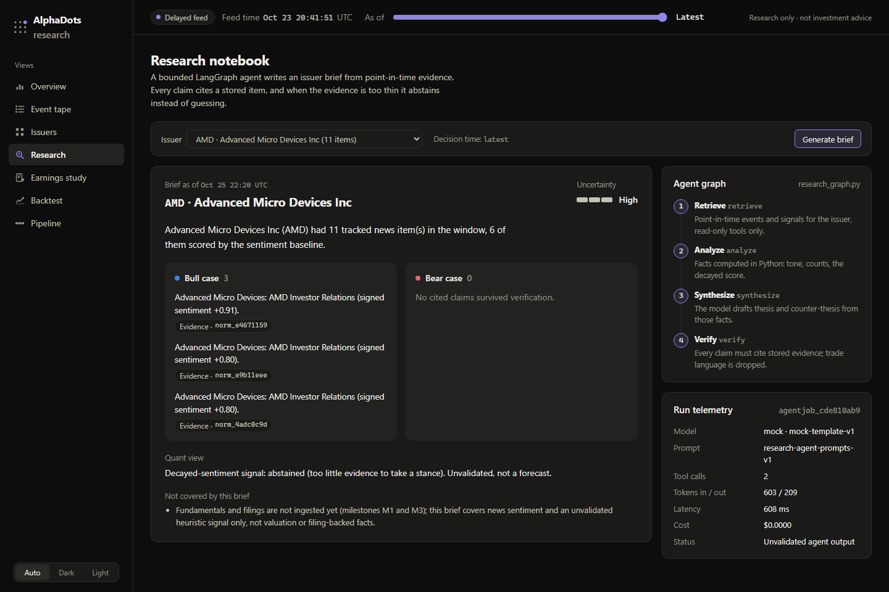
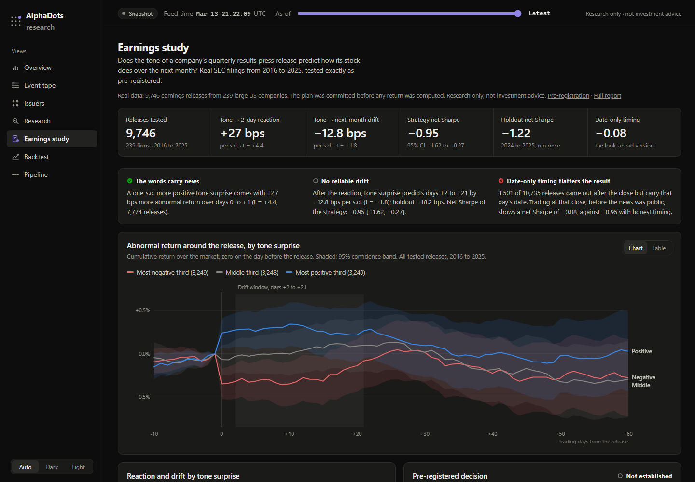
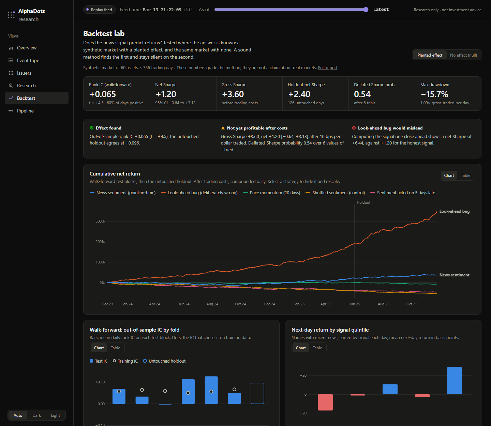

# AlphaDots

A point-in-time-correct research platform that turns financial news into sentiment
features and research signals, with every number traceable to its source and to the
moment it became knowable.



## What works today

- **Real data end to end.** The dashboard and `make demo` run on 535 real SEC EDGAR
  filings (8-K and 6-K, January to October 2026) from 40 large US companies and the
  five Indian companies that file with the SEC (Infosys, HDFC Bank, ICICI Bank, Wipro,
  Dr. Reddy's, under their NSE symbols). Each item carries the filing's own headline,
  the second EDGAR accepted it, and a link to it on sec.gov. Captured by
  `make capture`; see [data and licences](docs/data-licenses.md).
- **A pre-registered study on real data.** Does the tone of a company's quarterly
  results press release predict its stock over the next month? 9,746 SEC 8-K earnings
  releases (2016-2025) from 239 large US firms, each timed to the second EDGAR accepted
  it. The 300 candidates were chosen by 2014 public float, so the selection does not
  favour survivors; 61 have since been delisted and have no prices, which the report
  counts.
  Loughran-McDonald tone surprise, market and 6-factor abnormal returns, two-way clustered
  regressions, a cost-aware long-short portfolio with Newey-West alpha, a deflated Sharpe
  ratio over every variant tried, and a 2024-2025 holdout run once. The hypotheses were
  [committed before any return was computed](docs/research/earnings-tone-preregistration.md).
  **Result:** tone moves the two-day reaction (+27 bps per s.d., t = 4.4, holdout agrees)
  but does not predict the following month (t = −1.8; the sign hints at a partial
  reversal). The long-short trade is flat before costs and loses after them, and
  trading on the filing date alone, ignoring after-hours timing, would have looked 0.9
  of Sharpe better.
  [Report](docs/research/earnings-tone-study.md).
- **A typed, versioned event pipeline on Redpanda**: ingestion → preprocessing (markup
  stripping, exact dedup, effective-dated issuer resolution) → lexicon sentiment →
  decayed-sentiment signal → FastAPI read model.
- **Point-in-time correctness by construction.** Every read takes `as_of`. A score is
  hidden until its own `available_at`, and future data injected into tests changes nothing.
- **At-least-once delivery with idempotent effects.** Replays, redeliveries and restarts
  leave state byte-identical, and processing out of order gives the same signals.
- **A bounded LangGraph research agent.** It writes issuer briefs where every claim cites
  a stored item, and abstains when evidence is thin. A second graph monitors the
  pipeline. Runs on Groq with a key, or on a
  deterministic mock with none. See [ADR 0003](docs/adr/0003-bounded-research-agent.md).
- **A leakage-resistant backtest of the signal**, run where the right answer is known: a
  synthetic market with a planted effect and the same market with none. Expanding
  walk-forward with purge and embargo, `τ` chosen on training folds only, an untouched
  holdout, costs, block-bootstrap Sharpe intervals, a deflated Sharpe ratio, and controls
  (shuffled, lagged, price momentum, and a deliberate look-ahead bug). The method finds the
  planted effect and stays silent on the null; the look-ahead bug turns "no effect" into a
  Sharpe of +4.7. See the [study](docs/research/simulation-study.md).
- **A research dashboard**: a market overview (signal leaderboard, tone mix, daily news
  flow, issuer × day heatmap, strongest headlines), the event tape with provenance
  drill-down, issuer timelines, the research notebook, the earnings study, the backtest
  lab, and pipeline monitoring. An as-of slider shows exactly what the system knew at
  any moment, and every chart has a table view.
- **Deployable to Vercel as is.** With no backend attached, the dashboard serves the real
  pipeline's output over the real SEC filings, plus agent briefs recorded at export,
  from a parity-tested snapshot.
- **Deployment and DevSecOps**: multi-stage non-root images, Docker Compose profiles, a
  Helm chart and k3d config, Terraform for AWS (VPC, EKS, ECR, RDS, S3, OIDC IAM),
  GitHub Actions PR and release workflows, Prometheus and Grafana, six security scanners,
  an SBOM, and a [threat model](docs/threat-model.md).







## Tech stack: how each requirement is met

| Requirement | What we used | Where it lives | Status |
|---|---|---|---|
| **Microservices** | Six Python 3.12 services on FastAPI and asyncio: `ingestion`, `preprocessor`, `sentiment`, `signal_engine`, `api`, `research_agent`, plus the Next.js `web` app. They talk only through versioned Kafka topics on Redpanda (`news.raw.v1` … `reports.generated.v1`, typed with Pydantic v2), with idempotent consumers and a dead-letter topic. Each service owns its own tables. | [`services/`](services), [`libs/contracts`](libs/contracts), [architecture](docs/architecture.md) | Running locally (`make demo`); a test fails if one service imports another |
| **Docker** | Multi-stage builds (one shared [`service.Dockerfile`](infra/docker/service.Dockerfile) for every Python service, plus [`web/Dockerfile`](web/Dockerfile)). Non-root users, read-only root filesystems, dropped Linux capabilities, health checks, resource limits. Docker Compose profiles `core`, `jobs`, `agents`, `ui` and `obs`. | [`infra/docker`](infra/docker), [`infra/compose`](infra/compose) | All images build and run locally; CI builds every image |
| **Infrastructure as Code** | Terraform for AWS: modules `vpc`, `ecr`, `s3`, `eks`, `rds` (password generated into Secrets Manager) and `iam` (GitHub Actions OIDC, least-privilege roles), plus a `dev` environment with S3/DynamoDB remote-state guidance. | [`infra/terraform`](infra/terraform), [cost guardrails](docs/cost-guardrails.md) | `terraform validate` passes; never applied, to avoid AWS charges |
| **Kubernetes** | Helm chart: Deployments, StatefulSets for Redpanda and PostgreSQL, a topic-creation Job, an ingestion Job, ConfigMap, Secret references, readiness/liveness probes, resource limits, NetworkPolicy, PodDisruptionBudget and an optional HPA. A k3d cluster config with `make k8s-up`, `k8s-smoke` and `k8s-down`. | [`infra/helm/alphadots`](infra/helm/alphadots), [`infra/k3d`](infra/k3d), [runbook](docs/deployment-runbook.md) | `helm lint`/`helm template` pass and Checkov scans the rendered manifests in CI; a live k3d cluster could not be created on the development machine (see limitations) |
| **CI/CD** | GitHub Actions with every action pinned by commit SHA. [`pr.yml`](.github/workflows/pr.yml): lint, strict mypy, tests with an 80% coverage gate, integration tests on real Redpanda and PostgreSQL, security scans, image build plus Trivy, Checkov. [`release.yml`](.github/workflows/release.yml): builds and pushes all 7 images to GHCR with recorded digests and a CycloneDX SBOM each, a staging deploy via OIDC, and a production deploy behind manual approval with a rollback command. Vercel deploys the dashboard from GitHub. | [`.github/workflows`](.github/workflows) | Release workflow green on `main`; the deploy jobs do nothing until an AWS role is configured |
| **DevSecOps** | Gitleaks (secrets), Semgrep (static analysis), pip-audit and `pnpm audit` (dependencies), Trivy (images and misconfiguration), Checkov (Terraform and Helm), CycloneDX SBOMs, OIDC instead of long-lived cloud keys, scoped exception files ([`.trivyignore`](.trivyignore), [`.gitleaks.toml`](.gitleaks.toml)), and a STRIDE [threat model](docs/threat-model.md). | `make security`, [`scripts/tasks.py`](scripts/tasks.py) | Gitleaks, Semgrep, the dependency audits and Trivy block a merge; Checkov reports only, until a waiver policy exists |
| **Cloud provider / local machine** | **Local first:** Docker Compose runs the whole platform with Prometheus, Grafana and Pushgateway, with no credentials needed; k3d for local Kubernetes. **Cloud, optional:** AWS (EKS, ECR, RDS, S3, Secrets Manager, IAM OIDC) through the Terraform above. **Hosting:** Vercel serves the dashboard from a parity-tested snapshot. | [`infra/compose`](infra/compose), [`infra/terraform`](infra/terraform), [Vercel guide](docs/deployment-vercel.md) | Local stack verified end to end; AWS is a planned shape, not a live deployment |

**Application stack:** Python 3.12 with uv, FastAPI, Pydantic v2, SQLAlchemy, asyncio,
Redpanda (Kafka API), PostgreSQL, LangGraph (Groq or a deterministic mock model), NumPy
for the research studies, Next.js 16 with TypeScript for the dashboard, and Prometheus
plus Grafana for observability. Data: SEC EDGAR, Kenneth French factors, the
Loughran-McDonald dictionary and Yahoo prices (local only); see
[data and licences](docs/data-licenses.md).

## Quick start

Requirements: Python 3.12, [uv](https://docs.astral.sh/uv/), Node 22 with pnpm, and
Docker for the full stack. Every `make` target also runs without make as
`uv run python -m scripts.tasks <target>`, which is the easier route on Windows.

**1. Dashboard only (snapshot mode, nothing else needed)**

```bash
cd web && pnpm install && pnpm dev        # http://localhost:3000
```

**2. Whole pipeline in one process, no Docker**

```bash
uv sync
make dev                                  # API on http://localhost:18000/docs
# in another terminal:
cd web && ALPHADOTS_API_URL=http://localhost:18000 pnpm dev
```

`make dev ARGS="--speed 20000"` paces the replay so the tape fills in live.

**3. The real stack: Redpanda, PostgreSQL and one container per service**

`make demo` does all of it on the **real** dataset: resets the local volumes, starts
every profile, replays the SEC filings, asks the research agent for briefs and prints
the URLs, so every dashboard (the web app on :13000, Grafana on :13001) has data. The
step-by-step targets below use the deterministic synthetic fixtures, which is what the
smoke checks expect; set `ALPHADOTS_DATASET=real ALPHADOTS_FEED_MODE=delayed` to run
them on real data instead.

```bash
make up          # builds images, starts everything, waits until healthy
make seed        # curated fixture (idempotent; run it twice and nothing changes)
make smoke       # 13 end-to-end checks against the running API
make replay      # bulk fixture; add SPEED=20000 for a paced live tape
make agents      # research agent (Groq if ALPHADOTS_GROQ_API_KEY is set, else mock)
make agent-smoke # 9 checks: jobs, idempotency, citations, abstention, monitoring
make ui          # dashboard container on http://localhost:13000
make obs         # Prometheus on :19090, Grafana on http://localhost:13001
make down        # ARGS=--volumes also deletes data
```

Grafana opens the pipeline dashboard without a login (anonymous, read-only, bound to
127.0.0.1). To edit, sign in as `admin` with `ALPHADOTS_GRAFANA_PASSWORD` (default
`admin`). Run-once jobs such as ingestion push their metrics to a Prometheus Pushgateway,
so the ingest panels stay filled after the job exits.

**4. The research studies**

```bash
make research        # simulation study: a few seconds; rewrites the Backtest page data
make earnings-data   # real data, once: about an hour, resumable, cached in var/research
make earnings-study  # offline from the cache: about 20 s once text features are cached
```

`make earnings-data` needs `ALPHADOTS_SEC_USER_AGENT="Your Name you@example.com"` in
`.env` (SEC fair-access policy). Downloads are never committed; see
[data and licences](docs/data-licenses.md) for each source's terms.

Kubernetes: `make k8s-up`, `make k8s-smoke`, `make k8s-down` (k3d and Helm). Steps,
rollback and the AWS path are in [`docs/deployment-runbook.md`](docs/deployment-runbook.md);
what AWS would cost, and why nothing applies it automatically, is in
[`docs/cost-guardrails.md`](docs/cost-guardrails.md).

## Deploy the dashboard to Vercel

Import the repository in Vercel, set **Root Directory** to `web`, and deploy. No
environment variables are needed: it serves the bundled snapshot of the real SEC
filings, including a recorded research brief for every issuer, and shows an
**SEC filings · snapshot** chip. Set `ALPHADOTS_API_URL`
(and optionally `ALPHADOTS_API_TOKEN`) to attach a running API instead, which also
enables generating new briefs.

Vercel cannot run Kafka consumers or databases, so the pipeline itself is not deployed
there. [`docs/deployment-vercel.md`](docs/deployment-vercel.md) covers both modes, the
CLI route, security properties and caching.

## Tests and checks

| Command | What it covers |
|---|---|
| `make test` | Python unit, contract, point-in-time leakage and end-to-end tests (in-memory bus, no Docker), plus dashboard parity against the real API |
| `make test-integration` | The same pipeline on throwaway Redpanda and PostgreSQL containers: offset resume after restart, full redelivery, Kafka/Postgres output identical to the in-memory run |
| `make lint` | ruff, strict mypy, schema-snapshot and fixture drift, snapshot drift, research-results drift, ESLint, `tsc` |
| `make security` | pip-audit, `pnpm audit`, Gitleaks, Semgrep, Trivy (gating); Checkov (reporting); CycloneDX SBOM |
| `make web-build` | The production dashboard build Vercel runs |

CI runs the same gates on every pull request (`.github/workflows/pr.yml`), plus a Trivy
scan of every built image and a coverage floor of 80% (currently about 95%).

Tests worth reading first:
[`tests/temporal_leakage`](tests/temporal_leakage/test_point_in_time.py),
[`tests/research`](tests/research/test_study.py),
[`tests/e2e`](tests/e2e/test_pipeline.py) and
[`web/test/parity.test.ts`](web/test/parity.test.ts).

## Repository layout

```text
libs/contracts     versioned Pydantic messages, topic registry, schema compatibility
libs/common        bus (Kafka + in-memory), worker loop, config, logging, metrics, DB
libs/quant         decayed-sentiment aggregate with the point-in-time guard
libs/llm           bounded LLM adapter: Groq over plain httpx, deterministic mock for CI
services/          ingestion · preprocessor · sentiment · signal_engine · api · research_agent
research/          offline studies: simulation (walk-forward, deflated Sharpe) and the
                   real-data earnings study (EDGAR client, event timing, clustered OLS)
web/               Next.js dashboard (live proxy or bundled snapshot)
data/real/         real SEC 8-K/6-K filings and instruments (make capture), hash-pinned
data/fixtures/     synthetic news (CC0) for deterministic tests, hash-pinned by MANIFEST.json
infra/compose      Docker Compose stack and throwaway integration stack
infra/helm, k3d    Helm chart and local cluster config
infra/terraform    AWS modules and the dev environment (validated, never applied)
observability/     Prometheus scrape config, Grafana datasource and dashboard
.github/workflows  PR verification and release workflows
scripts/           task runner, fixture generator, snapshot exporter, smoke checks
tests/             unit · contract · temporal_leakage · research · e2e · integration
docs/              architecture, research report, threat model, runbooks, ADRs
```

## Documentation

- [Architecture](docs/architecture.md): event flow, contracts, the availability model,
  delivery guarantees
- [Earnings study](docs/research/earnings-tone-study.md) and its
  [pre-registration](docs/research/earnings-tone-preregistration.md): real filings and
  returns, what held up, what did not
- [Simulation study](docs/research/simulation-study.md): method, results, what failed,
  and whether it justifies more work
- [Data and licences](docs/data-licenses.md): what the fixtures contain and why each seed
  line exists
- [Deploying to Vercel](docs/deployment-vercel.md) and the
  [deployment runbook](docs/deployment-runbook.md) (Compose, k3d/Helm, AWS)
- [Threat model](docs/threat-model.md) and [cost guardrails](docs/cost-guardrails.md)
- ADRs: [0001 M0 scope](docs/adr/0001-m0-vertical-slice.md),
  [0002 dashboard snapshot mode](docs/adr/0002-dashboard-snapshot-mode.md),
  [0003 bounded research agent](docs/adr/0003-bounded-research-agent.md)

## Known limitations

- The sentiment model is a small hand-written lexicon. It is easy to fool; one fixture
  shows a prompt-injection sentence raising its score. On the real filings it abstains
  on about half (no lexicon match), and some scores are noisy. FinBERT (M2) is the fix.
- Real-data headlines are extracted by rules from each filing; a few are imperfect
  (wrapped titles cut short, generic "Other events"). Every item links to its source.
- The earnings study uses Yahoo prices, which are not licensed for automated download;
  that was the owner's choice, the data stays local, and only aggregates are published.
  Prices exist only for firms still listed (61 of 300 are missing), so the results
  describe survivors. Swap `daily_bars` for a licensed source before any other use.
- The simulation backtest runs on a synthetic market. It shows the evaluation can tell a real
  effect from none; it says nothing about real returns. Even in the planted world the
  daily-rebalanced strategy is not robustly profitable after 10 bps costs (net Sharpe 95%
  interval −0.64 to +3.13, deflated Sharpe probability 0.54). The live signal engine still
  uses a configured `τ`.
- Dedup is exact-match after normalisation. "First processed wins" is not yet
  order-independent (M1 watermark policy).
- Indian coverage is limited to companies that file with the SEC; others (Reliance, TCS)
  need a licensed NSE/BSE feed, not scraping. The real feed is a backfill from the
  EDGAR archive, labelled delayed; a live EDGAR poller is the next M1 step.
- The Helm chart is linted and templated, but `k3d cluster create` could not run on the
  development machine (it cannot reach ghcr.io for k3d's helper image). The AWS
  Terraform passes `validate` and has never been applied.
- Not yet built: a streaming SEC adapter in the live pipeline (M1), FinBERT (M2), live
  market data, LightGBM and MLflow (M3), and benchmarks (M6). The matching `make`
  targets fail with the milestone that owns them instead of pretending.
