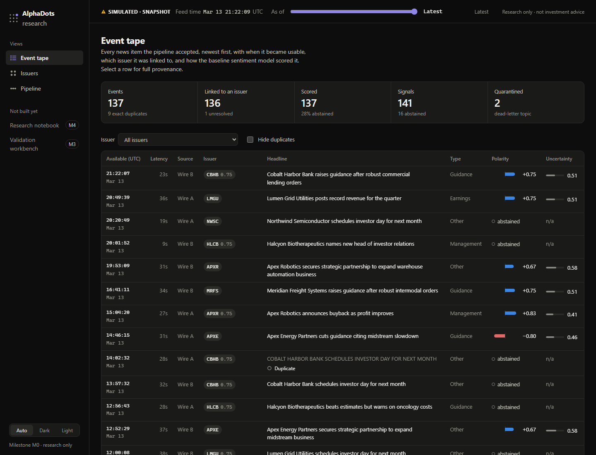
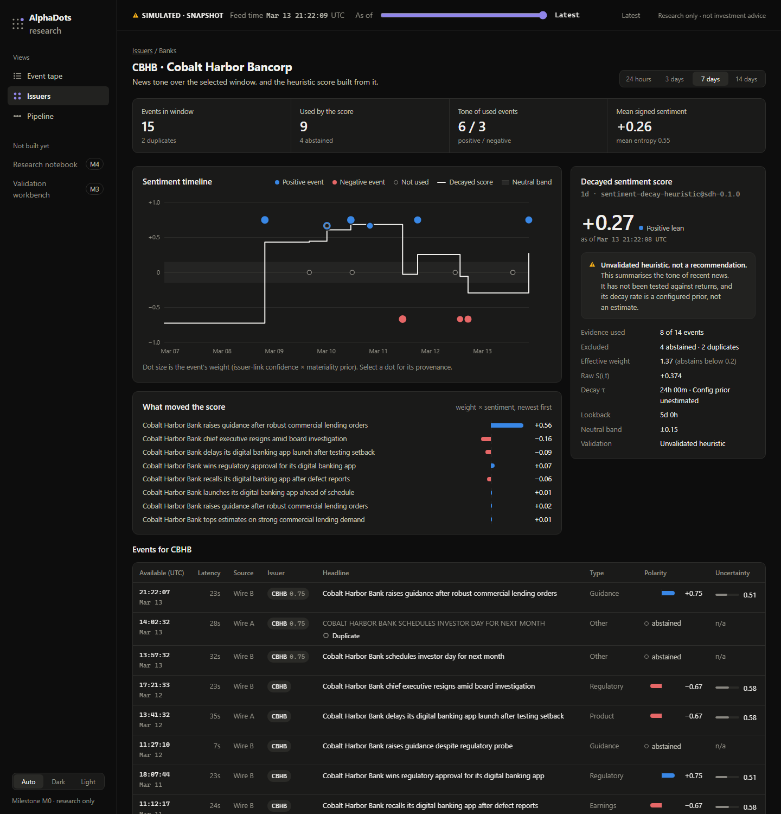

# AlphaDots

A point-in-time-correct research platform that turns financial news into sentiment
features and research signals, with every number traceable to its source and to the
moment it became knowable.

> **Status: milestone M0, research only.** All data is synthetic. The sentiment model is
> a deliberately simple baseline and the signal is an unvalidated heuristic. Nothing
> here is investment advice, and no predictive or performance claims are made.
> The roadmap is in [`CLAUDE.md`](CLAUDE.md).



## What works today

- **A typed, versioned event pipeline on Redpanda**: ingestion → preprocessing (markup
  stripping, exact dedup, effective-dated issuer resolution) → lexicon sentiment →
  decayed-sentiment signal → FastAPI read model.
- **Point-in-time correctness by construction.** Every read takes `as_of`. A score is
  hidden until its own `available_at`, and future data injected into tests changes nothing.
- **At-least-once delivery with idempotent effects.** Replays, redeliveries and restarts
  leave state byte-identical, and processing out of order gives the same signals.
- **A research dashboard** with a live event tape, provenance drill-down and issuer
  timelines. An as-of slider shows exactly what the system knew at any moment.
- **Deployable to Vercel as is.** With no backend attached, the dashboard serves the real
  pipeline's output from a bundled, parity-tested snapshot.



## Quick start

Requirements: Python 3.12, [uv](https://docs.astral.sh/uv/), Node 22 with pnpm, and
Docker for the full stack. Every `make` target also runs without make as
`uv run python -m scripts.tasks <target>`, which is the easier route on Windows.

**1. Dashboard only (snapshot mode, nothing else needed)**

```bash
cd web && pnpm install && pnpm dev        # http://localhost:3000
```

**2. Whole pipeline in one process, no Docker**

```bash
uv sync
make dev                                  # API on http://localhost:18000/docs
# in another terminal:
cd web && ALPHADOTS_API_URL=http://localhost:18000 pnpm dev
```

`make dev ARGS="--speed 20000"` paces the replay so the tape fills in live.

**3. The real stack: Redpanda, PostgreSQL and one container per service**

```bash
make up          # builds images, starts everything, waits until healthy
make seed        # curated fixture (idempotent; run it twice and nothing changes)
make smoke       # 13 end-to-end checks against the running API
make replay      # bulk fixture; add SPEED=20000 for a paced live tape
make ui          # dashboard container on http://localhost:13000
make down        # ARGS=--volumes also deletes data
```

## Deploy the dashboard to Vercel

Import the repository in Vercel, set **Root Directory** to `web`, and deploy. No
environment variables are needed: it serves the bundled snapshot and says so on screen.
Set `ALPHADOTS_API_URL` (and optionally `ALPHADOTS_API_TOKEN`) to attach a running API
instead.

Vercel cannot run Kafka consumers or databases, so the pipeline itself is not deployed
there. [`docs/deployment-vercel.md`](docs/deployment-vercel.md) covers both modes, the
CLI route, security properties and caching.

## Tests and checks

| Command | What it covers |
|---|---|
| `make test` | Python unit, contract, point-in-time leakage and end-to-end tests (in-memory bus, no Docker), plus dashboard parity against the real API |
| `make test-integration` | The same pipeline on throwaway Redpanda and PostgreSQL containers: offset resume after restart, full redelivery, Kafka/Postgres output identical to the in-memory run |
| `make lint` | ruff, strict mypy, schema-snapshot and fixture drift, snapshot drift, ESLint, `tsc` |
| `make security` | pip-audit, `pnpm audit`, gitleaks |
| `make web-build` | The production dashboard build Vercel runs |

Tests worth reading first:
[`tests/temporal_leakage`](tests/temporal_leakage/test_point_in_time.py),
[`tests/e2e`](tests/e2e/test_pipeline.py) and
[`web/test/parity.test.ts`](web/test/parity.test.ts).

## Repository layout

```text
libs/contracts     versioned Pydantic messages, topic registry, schema compatibility
libs/common        bus (Kafka + in-memory), worker loop, config, logging, metrics, DB
libs/quant         decayed-sentiment aggregate with the point-in-time guard
services/          ingestion · preprocessor · sentiment · signal_engine · api
web/               Next.js dashboard (live proxy or bundled snapshot)
data/fixtures/     synthetic, CC0, hash-pinned by MANIFEST.json
infra/             Dockerfile, compose stack, throwaway integration stack
scripts/           task runner, fixture generator, snapshot exporter, smoke check
tests/             unit · contract · temporal_leakage · e2e · integration
docs/              architecture, data licences, Vercel deployment, ADRs
```

## Documentation

- [Architecture](docs/architecture.md): event flow, contracts, the availability model,
  delivery guarantees
- [Data and licences](docs/data-licenses.md): what the fixtures contain and why each seed
  line exists
- [Deploying to Vercel](docs/deployment-vercel.md)
- ADRs: [0001 M0 scope](docs/adr/0001-m0-vertical-slice.md),
  [0002 dashboard snapshot mode](docs/adr/0002-dashboard-snapshot-mode.md)

## Known limitations

- The sentiment model is a small hand-written lexicon. It is easy to fool; one fixture
  shows a prompt-injection sentence raising its score.
- Signals summarise news tone. They have not been tested against returns, and `τ` is a
  configured prior.
- Dedup is exact-match after normalisation. "First processed wins" is not yet
  order-independent (M1 watermark policy).
- Not yet built: market data and backtesting (M3), FinBERT (M2), the research agent (M4),
  Kubernetes, Terraform, CI/CD and the threat model (M5), and benchmarks (M6). The
  matching `make` targets fail with the milestone that owns them instead of pretending.
